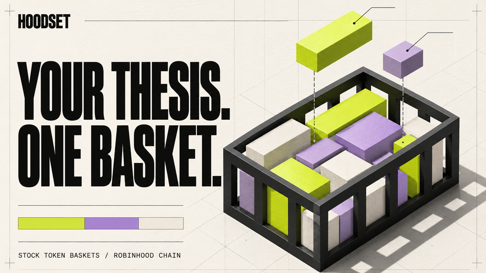

# HOODSET

**Your thesis. One basket.**

Custom Stock Token baskets on Robinhood Chain. Choose a composition, inspect its underlying assets, and mint or redeem fixed-composition shares through your own wallet.

[HOODSET on X](https://x.com/hoodsetq) · [Template methodology](docs/templates.md) · [Robinhood Chain docs](https://docs.robinhood.com/chain/)



## What works

- Discover and watchlist, editable basket templates, and comparison by composition or historical price return.
- Real RH asset metadata and token-adjusted reference prices. A missing or stale component stops valuation.
- Split-adjusted daily underlying price history through a server-side Twelve Data integration; an optional local SQLite / hosted D1 cache.
- Browser wallet connection, balances, and a builder for 2–12 supported components with initial weights totaling 100%.
- A reproducibly compiled fixed-composition vault, share minting, pro-rata redemptions, reserved exits, and claims.
- Guided USDG funding: check every component route, buy components, approve exact deposits, then mint into the selected vault.
- Guided USDG exit: preview pro-rata redemption, redeem shares, then sell the received components. Progress and receipts are recoverable in the same browser.

**Current status:** development preview. Wallet-funded mainnet buy → mint → sell verification remains outstanding. No independently audited or production-safe status is claimed. This repository includes functional transaction code; every real write requires review and confirmation in your wallet. The separate `/paper.html` sandbox is explicitly simulated.

## Run locally

Use Node.js **24** and npm:

```sh
npm ci
npm test
npm run build
npm run dev
```

Open `http://127.0.0.1:4317`. Build before starting the server, and rebuild after source changes. No API key is required for the interface, public metadata, or OpenOcean public quotes. Reference RPC/API availability and swap liquidity still depend on the providers.

For annual history, copy `.env.example` to `.env` and set your own **server-only** `TWELVE_DATA_API_KEY`. An optional `RH_RPC_URL` configures a dedicated read RPC. Keep credentials out of browser code and Git. Check your data provider's display rights before publishing market data.

A fresh checkout has no featured private user vault or wallet. Create a vault through the builder, or import an existing compatible vault address on **Onchain baskets**. Deployment buys no stocks. Inspect its composition and backing before funding it.

## How a basket works

Initial weights and current prices determine fixed token quantities per share. Later price moves change current weights; the vault does not automatically rebalance. Shares claim a proportional amount of active underlying balances. Reserved exits are excluded from active backing.

Funding is a guided sequence of separate transactions, not an atomic purchase: approvals, component swaps, token approvals, and minting. If you pause, decline, or encounter a failed route, tokens already acquired remain in your wallet. Selling similarly redeems into components before individual USDG swaps. ETH gas is additional for each transaction.

Stock Tokens represent the parent-company or ETF exposure described by the issuer; owning a token for a diversified company does not isolate its AI division. Availability depends on jurisdiction and issuer restrictions. This is an independent project and is not affiliated with Robinhood or the companies shown.

## Historical returns

The historical calculator applies the selected composition and starting weights to real split-adjusted daily underlying closes, then holds fixed quantities. It excludes cash dividends, fees, gas, and RH token multiplier effects. It is a retrospective illustration using today's selection, not an issued vault's track record, a forecast, or a recommendation. Missing histories stay unranked.

## Checks

```sh
npm test
npm run build
```

The application suite uses deterministic fixtures; it does not submit transactions. The contract integration suite runs only against a local Anvil node:

```sh
ANVIL_BIN=/path/to/anvil npm run test:contracts
```

Compilation uses pinned Solidity and OpenZeppelin versions. `npm run build` generates the ABI, runtime hash, compiler input, browser bundles, and a self-contained Worker in `dist/server/index.js`. Local checks are not an independent contract audit.

## Structure

| Path | Responsibility |
| --- | --- |
| `client/` | Wallet UI, basket math, funding and liquidation flows |
| `contracts/` | Vault and canonical asset constants |
| `shared/` | Quote validation, receipt settlement, historical calculations |
| `worker/` | Read APIs, history cache, static assets |
| `web/` | Interface styles, paper sandbox, fonts and artwork |
| `db/`, `drizzle/` | Cache schema and migrations |
| `scripts/` | Reproducible build and local server |
| `tests/` | Deterministic fixtures and local EVM integration tests |

## License and assets

No repository-wide license has been selected. Contract SPDX notices and third-party licenses apply to their respective files. Fonts retain their SIL Open Font License notices in `web/assets/type/`. Company marks identify underlying instruments and do not imply endorsement. HOODSET artwork uses the existing project visual system; the introduction image was generated with OpenAI image generation.
